# ZenML Bench: how it works and what every task tests

*Last checked against the repository: 2026-11-23 (ZenML 0.96.4, task set v0.1). Live pass rates and costs are generated into the [`README.md` results table](../README.md#results); what baselines revealed is in [`findings.md`](findings.md).*

ZenML Bench tests whether a coding agent can build, debug, configure, and run real ML pipelines using [ZenML](https://www.zenml.io). Each task drops an agent into a small, working Python project with one realistic problem or job left undone.

Instead of grading prose or diffs, a hidden grader **inspects the state ZenML actually recorded** (runs, step statuses, cache keys, artifacts, model versions, compiled settings) and **re-runs the agent's code on inputs it never saw**. Scores are binary: `1` or `0`.

This page is the plain-language tour of every task and how grading works. The sister page for the Kitaru set is [`kitaru-bench.md`](kitaru-bench.md). To write or modify tasks, see [`task-authoring.md`](task-authoring.md).

## Key ZenML concepts used here

If you are new to ZenML, five concepts explain almost every task on this page:

| concept | plain-English meaning |
|---|---|
| **pipeline & steps** | A Python workflow made of `@step` functions wired together inside a `@pipeline`. ZenML tracks every run and step status in its store. |
| **cache key** | Before running a step, ZenML hashes its code, parameters, and input artifact IDs. If the hash matches a past run, the step is skipped (`cached`). |
| **artifact & materializer** | Every step output is saved as a versioned **artifact** by a **materializer** (a serializer/deserializer). Downstream steps receive artifacts as typed inputs. |
| **model version & stage** | A named ZenML Model (like `demand_forecaster`) groups versioned artifacts and metrics; a **stage** (like `production`) points at the active version. |
| **repository (`.zen`) & stack** | ZenML finds a project's root by walking up to the nearest `.zen` directory, and runs pipelines against an active **stack** (orchestrator, artifact store, container registry, etc.). |

## Anatomy of a task: `b3-stale-cache`

To see what makes these tasks hard, look at one task end-to-end: **`b3-stale-cache`**.

- **What the agent gets:** A working `nightly_training` pipeline (`load_data(path) → train(df) → evaluate(model, df)`) where `train` sleeps for 3 seconds to stand in for expensive training. The prompt says: *"Yesterday `data/train.csv` was replaced with new rows at the same path, but the pipeline kept reporting the old evaluation score because ZenML served cached results. Make changed data re-run dependent steps while keeping `train` cached when the file has not changed. Do not disable caching for the whole pipeline."*
- **Why the obvious fix fails:** ZenML hashes `load_data`'s parameter — the path *string* `"data/train.csv"` — not the file's contents. Many agents respond by adding `enable_cache=False` to `load_data`. The score now updates and the run looks green, **yet it scores 0**: each fresh DataFrame returned by `load_data` gets a new artifact ID (and pandas has no content hash), so `train` now misses its cache on *every* run.
- **What actually works:** Give ZenML a content hash of the file (via a small hashing step, a custom `cache_func`, or `file_dependencies`), so `load_data` re-runs *only* when bytes change and `train` stays cached otherwise.
- **How the grader proves it:** The grader swaps unseen CSV fixtures `a, a, b, b, c` into `data/train.csv`, runs `python run.py` five times, and checks both the scores and the recorded step statuses:

Every task in ZenML Bench follows this pattern: **real ZenML behaviour creates a plausible shortcut that goes green locally and still fails grading.**

---

## The 18 tasks, grouped by what they test

*(Task IDs reflect the original design plan; numbers like `B8`, `B12`, and `B13` were deferred rather than built, so IDs are not contiguous.)*

### 1. Caching & determinism (2 tasks)

Projects: `nightly` (B3) and `sampling` (B4).

B3 (walked through above) tests making a cache *invalidate* when file contents change without breaking downstream caching. B4 tests the mirror problem: a QA sampling pipeline (`load_events() → sample_events(events, n) → review_report(sample)`) over 20,000 synthetic payment events caches the random sampler, so every QA review inspects the exact same 50 events.

| task | goal | the trap & how it's graded |
|---|---|---|
| `b3-stale-cache` | Make changed data at `data/train.csv` invalidate downstream steps while unchanged reruns keep `train` cached. | **Trap:** `enable_cache=False` on `load_data` creates a new DataFrame artifact ID every run, silently busting `train`'s cache. **Graded on:** 5 grader runs with unseen fixtures `a, a, b, b, c`: right scores, `train` executed on runs 3 & 5 and cached on 2 & 4. |
| `b4-nondeterministic-step` | Make `sample_events` draw a fresh random sample every run while the slow `load_events` step stays cached. | **Trap:** `CachePolicy(expires_after=0)` looks like "expire immediately", but `0` means unset so the step stays cached; disabling cache on the loader or report also fails. **Graded on:** 2 grader runs with an unseen `n`: loader cached, sampler executed, samples differ, each report matches its own sample. |

### 2. Pipeline authoring & migration (3 tasks)

Projects: `credit_script` (B2), `legacy_training` (B9), and `churn_scoring` (B5).

These tasks test core authoring skills: converting plain Python into a ZenML pipeline, modernising old ZenML code, and persisting objects that pickle cannot handle.

| task | goal | the trap & how it's graded |
|---|---|---|
| `b2-script-to-pipeline` | Turn a plain `train.py` (`prepare`, `train`, `evaluate` on 2,400 synthetic credit rows) into pipeline `credit_training` with ≥ 3 typed steps and artifacts `model` and `accuracy`. | **Trap:** Returning `train_test_split(...)` without a `Tuple[...]` return annotation creates *one* tuple output instead of four; an `evaluate` step that retrains gets the right number without wiring the `model` artifact. **Graded on:** Entrypoint run on visible + unseen 900-row data: accuracy matches the original script and `evaluate` takes `model` as a recorded step input. |
| `b9-modernise-old-api` | Upgrade a 4-step training pipeline (`load_data → split → train → evaluate`) written in ZenML 0.4x (`BaseParameters`, `Output(...)`, `post_execution`) to run identically on 0.96.4. | **Trap:** Unlearning 0.4x conventions: missing `Tuple` annotations collapse multi-output steps, and invoking a step standalone registers an extra stray pipeline. **Graded on:** Runs on visible and unseen data: exact pipeline name, step names, output names, recorded step parameters, and evaluation score. |
| `b5-custom-materializer` | Symptom only (`TypeError: cannot pickle 'sqlite3.Connection'`): make `churn_training` (`load_data → train → evaluate`) complete and store `ChurnScorer` as artifact `churn_scorer` so `serve.py` scores identically in a fresh process. | **Trap:** `ChurnScorer` holds an in-memory SQLite table of segment adjustments plus features and a threshold. Saving a bare model or guessing the threshold runs green and scores wrong. **Graded on:** Grader run produces `churn_scorer`; a fresh Python process loads it and scores unseen data within `1e-6`. |

### 3. Run history & artifact lineage (4 tasks)

Projects: `daily_report` (B10, B14, B14H) and `daily_report_hard` (B10H).

All four tasks use a regional sales pipeline (`load(date) → parse → summarise → write_report`). During image build, ZenML actually runs the pipeline across multiple days—producing real completed runs, real failures, and real artifacts—so the agent has to query ZenML's store rather than guess from source files. Scheduled runs are named `scheduled-<date>` (tagged `scheduled`); manual runs are named `manual-<date>-<time>` (tagged `manual`).

**Debugging failures (`B10`, `B10H`):** Most seeded failures are operational distractors (missing export file, missing `reports/` directory, or a hand-run typo for `2026-09-31` that ran *after* `09-09` and is therefore the most recent failed run overall). Only the ringed runs are code faults:

**Tracing artifact lineage (`B14`, `B14H`):** Backfill runs from late August were run by hand and tagged `backfill` afterwards. In `B14H`, three backfill days were re-processed with corrected exports, introducing a supersession rule (*"the most recent completed processing of a day counts"*). Putting the actual day totals in the cells shows why every simpler filter lands on the wrong run:

| task | goal | the trap & how it's graded |
|---|---|---|
| `b10-why-did-it-fail` | The latest scheduled run failed: find the day and cause, fix the code so every row counts, and re-run that day. | **Trap:** The newest failed run overall is the manual `09-31` typo, not scheduled `09-09` (which failed in `parse` on `"1,234.50"`). Dropping or coercing bad rows goes green while losing revenue from totals. **Graded on:** Genuine completed `09-09` run with exact totals, plus two unseen exports (with/without separators); seeded history untouched. |
| `b10h-why-did-it-fail-hard` | As B10, without being told how scheduled runs are named, with the failed CSVs moved off the box, and requiring *every* code-preventable scheduled failure of the week to be fixed. | **Trap:** Re-running `09-09` blindly fails with file-not-found (evidence sits only in ZenML's traceback and `load` output artifact); `09-03` has a *second* code fault (`"North"` / `"west "` casing & whitespace); hard-coding `"North"` fails unseen regions. **Graded on:** Restored `09-09` export plus 4 hidden exports (plain, separators, odd regions, both). |
| `b14-artifact-retrieval` | Find the completed backfill run with the largest total, and build a one-step `region_report` pipeline whose recorded input is that run's summary artifact. | **Trap:** `08-26` (`30,165`) failed in `write_report`; scheduled `09-08` (`22,383`) is not a backfill; recomputing from the CSV gets the right number without ZenML artifact lineage. **Graded on:** Recorded step input points to `08-27`'s (`16,506`) summary artifact; report matches; grader also runs `region_report.py <id>` on an unseen summary. |
| `b14h-artifact-retrieval-hard` | As B14, with re-processed days under the supersession rule, and the report must cite the artifact's ZenML name and version. | **Trap:** Every naive rule picks a different run—largest summary (`08-26` first, `17,170`), largest completed (`08-27` first, `16,689`), latest any status (`08-25` v2, `16,986`), any run (`09-08`, `22,383`). Only supersession picks **`08-26` v2** (`16,419`, `daily_report::summarise::output` v5). **Graded on:** As B14, plus exact cited artifact name and version. |

### 4. Models, stacks & repository roots (4 tasks)

Projects: `model_promotion` (B6), `k8s_training` (B7), `stack_onboarding` (B11), and `analytics_workspace` (B1).

These tasks test operational ZenML mechanics: model stage promotion, Kubernetes pod configuration, offline stack registration, and repository root discovery.

**Model promotion (`B6`):** The image trains `demand_forecaster` v1 (linear, lower `val_mae` = better) and v2 (random forest, worse), then runs `batch_forecast` once (picking "latest", v2). Simply switching inference to `Model(version="production")` fails when the grader flips `production` to the other version on the same batch:

**Repository roots (`B1`):** ZenML records step module paths relative to the nearest parent `.zen` folder. A stray `.zen` inside `analytics/jobs/backfill/` truncates backfill step paths, while a neighbouring project (`/app/legacy_reports`) has its own `.zen` and recorded run that must stay untouched:

| task | goal | the trap & how it's graded |
|---|---|---|
| `b6-model-promotion` | Promote the lower-`val_mae` version of `demand_forecaster` to `production` and make `batch_forecast` always follow that stage. | **Trap:** The model version is not part of ZenML's cache key—switching to `Model(version="production")` still serves cached predictions from the previous version on the same input batch. **Graded on:** Better version holds `production`; grader then promotes the *other* version and re-runs on the same hidden batch—both link and predictions must change. |
| `b7-kubernetes-settings` | Give only the `train` step's pod 1 GPU, 8Gi memory, node selector `gpu=true`, and service account `pipeline-runner` on `k8s-stack` (leaving `default` active and other steps untouched). | **Trap:** `pod_settings.service_account_name` looks valid and ZenML accepts it silently, but it is not a real field; setting `service_account_name` at the orchestrator top level also changes the orchestrator's pod. **Graded on:** Local run on `default`, then a dry-run compile against `k8s-stack` inspecting each step's compiled settings (no real cluster needed). |
| `b11-stack-registration` | Register an AWS service connector, an S3 artifact store linked to it, a Kubernetes orchestrator, and a container registry into stack `prod-k8s`, set it active *for this project*, and keep `default` intact. | **Trap:** There is no network route to AWS, so `artifact-store register --connector` tries to verify and leaves the store unlinked unless verification is bypassed; running `zenml stack set` outside the project changes the *global* stack instead of the project's. **Graded on:** Recorded components, connector link and bucket, project-scoped active stack, and a smoke run on `default`. |
| `b1-source-root-repair` | Make both `/app/analytics` entrypoints run with the repository root at `/app/analytics`, leaving `/app/legacy_reports` completely unchanged. | **Trap:** Patching `sys.path` leaves recorded step sources wrong; running `zenml init` at `/app` hijacks `legacy_reports`; leaving `jobs/backfill/.zen` keeps backfill paths truncated. **Graded on:** Grader runs both entrypoints (all step sources import from `/app/analytics`, `.zen` exists only there) and checks `legacy_reports` file hashes, `.zen`, and run are untouched. |

### 5. Research loops & framework comparison (5 tasks)

Projects: `research` (R1, R2, R1-clock) and `research_bare` (R1-bare, R1-bare-clock).

Unlike the B tasks, R tasks are open-ended iterative ML optimization on a binary classification problem (`research(config, seed)` attached to `research_model`). Progress is measured by **`gap_closed`**: how far the promoted model moves from the logistic-regression baseline (hidden log loss `0.6585`) toward a gradient-boosting reference (`0.4581`), where `0.5` is halfway.

Because ZenML lets you attach any artifact to any model version, **a link alone is not evidence**—the grader walks the full lineage chain before scoring on hidden data:

| task | goal | the trap & how it's graded |
|---|---|---|
| `r1-improve-within-budget` | Run at most 12 trials of `research`, lower validation log loss, and promote the best model version to `production`. | **Trap:** Promoting a hand-saved model, training on the full dataset, or editing evaluation code all fail lineage/row-digest checks. **Graded on:** `gap_closed ≥ 0.5` on hidden data through the verified chain, ≤ 12 runs, trained on the seed's slice. |
| `r2-screen-then-confirm` | As R1, except `production` must be backed by 3 completed runs on 3 *distinct* seeds with mean validation loss ≤ `0.56`. | **Trap:** Re-running the same seed 3 times produces cache hits instead of multi-seed evidence; promoting a lucky single seed scores 0. **Graded on:** All R1 checks plus the 3-distinct-seed evidence rule. |
| `r1-clock-improve-within-budget` | R1 under an explicit 25-minute wall-clock timeout and 2 CPUs enforced by Harbor. | **Trap:** Tool-call latency and iteration speed bind where the 12-run cap alone does not. **Graded on:** As R1, within the 25-minute clock. |
| `r1-bare-improve-within-budget` | The exact same problem with **no ZenML**: `train.py` logs to `results.tsv` and saves pickles; promotion copies a file to `best_model.pkl`. | **Trap:** The agent maintains its own lab notebook; deleting rows to hide extra runs is caught. **Graded on:** `best_model.pkl` matched by SHA-256 to a `results.tsv` row, then the same hidden-data `gap_closed` check. |
| `r1-bare-clock-improve-within-budget` | `r1-bare` with the same 25-minute / 2-CPU clock — the twin of `r1-clock`, differing only in whether ZenML is present. | **Purpose:** Built for the controlled with-vs-without-ZenML comparison in [`results/level3-comparison.md`](../results/level3-comparison.md). **Graded on:** As `r1-bare`. |

---

## How a run works & why the scores are trustworthy

Every task executes inside a single isolated container with a local SQLite ZenML store (no external server).

### Container & condition setup

- **Offline docs & restricted network:** Image builds and grading run with no network. During the agent's turn, egress is restricted to `api.anthropic.com`, `api.openai.com`, and `chatgpt.com` (requires OrbStack on macOS or Linux; Docker Desktop rejects the network policy; Terminus 2 calls its model from the host). Offline ZenML docs live at `/opt/zenml-docs/llms-full.txt`.
- **Time limits:** 30 minutes for B tasks, 40 minutes for R1 / R2 / R1-bare, and 25 minutes (with 2 CPUs) for the two clock tasks.
- **Tiers:** Tier A tasks use only the local SQLite store. Tier C tasks (`B7`, part of `B11`) register a Kubernetes stack with no real cluster and are graded by dry-run pipeline compilation.
- **Three conditions** let the exact same tasks test whether skills or MCP tools help:

| condition | what changes | how it's invoked |
|---|---|---|
| `bare` | container + offline docs only | default |
| `skill` | adds ZenML's `pipeline-authoring` and `quick-wins` skills from `zenml-io/skills` (pinned by SHA) | `harbor run --skill <dir>` (via `scripts/run_baselines.py`) |
| `mcp` | starts the ZenML MCP server over stdio against the container's local store | `harbor run --mcp-config shared/mcp/zenml.json` |

### Anti-cheating & quality gates

> **Why graders assume the store could be forged.** An RL-trained agent will take the shortest path to reward `1`—including writing fake rows straight into SQLite. So every non-research task ships a `tests/shortcuts/tamper_store.sh` script that hand-forges the "right" rows and **must score 0**.

- **Genuine-run verification:** `shared/checks/store_integrity.py` (`assert_genuine_run`) checks that every completed step has a valid cache key and real output files on disk, and that every cached step points to an original completed step in a *different* run with the same cache key and artifact versions. On top of that, graders run the agent's entrypoint themselves on unseen data and grade the new run ID.
- **Four checks before any task counts:**
  1. Reference solution (`solution/solve.sh`) scores `1` five times out of five.
  2. Doing nothing scores `0`.
  3. Every shortcut in `tests/shortcuts/` (disabling cache everywhere, hard-coding scores, forging the store, etc.) scores `0`.
  4. At least one different valid solution scores `1` (most tasks also verify `solve_then_run_twice.sh`, since real agents often re-run pipelines after fixing them).

### Generated instances (for RL training)

Eighteen hand-written tasks are enough for evaluation, not RL training. `scripts/generate_instances.py <family> --n N --seed S --out <dir>` generates verified variations by running each generated instance's reference solution through ZenML in a throwaway store to compute exact expected outputs and confirming the unfixed project fails as intended.

| family | base task | what varies per instance |
|---|---|---|
| `b10` | B10 | month/days, region names, fault type (thousands separators, region spelling, slashed dates, bracketed negatives, extra column), distractor failures, run naming/tags, pipeline name |
| `b3` | B3 | pipeline/step/output names, data path, whether path is a parameter, which step is expensive (trainer or evaluator), dataset size and noise |

Seeds `0–4` of each family are committed under `tasks/generated/` as a held-out set (the committed `b10` seeds use the date-format, bracketed-negative, and separator faults). Training sets use seeds `1000+` in gitignored `tasks/generated-train/`.

## Where things live

| what | where |
|---|---|
| Base image (ZenML pin, agent CLIs, docs, MCP server) | `shared/base/Dockerfile` |
| Shared projects (13 total) | `shared/projects/<project>/` (synced into tasks via `scripts/sync_project.sh`) |
| Task definitions (18 total) | `tasks/<id>/` (`instruction.md`, `task.toml`, `environment/`, `solution/`, `tests/`) |
| Forged-store check | `shared/checks/store_integrity.py` (synced via `scripts/sync_checks.sh`) |
| Verification & fast local grading | `scripts/verify_task.py <task>` (Harbor); `scripts/grade_local.sh <task> [patch.sh]` (seconds, no container) |
| Baselines & README score table | `scripts/run_baselines.py`, `scripts/results_table.py`, `results/` |
| Design rationale & baseline analysis | [`docs/decisions.md`](decisions.md), [`docs/findings.md`](findings.md) |
